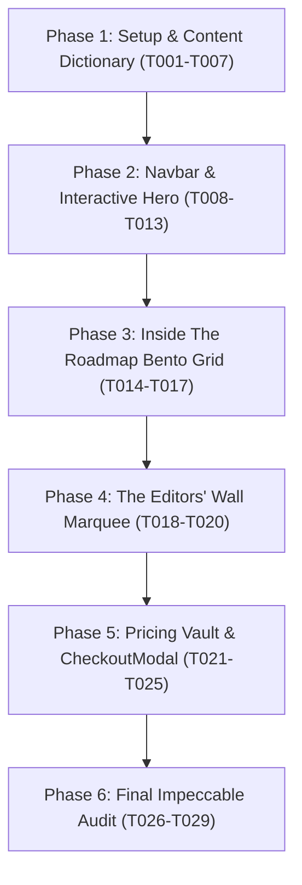

# Tasks: High-Conversion Video Editor Roadmap Landing Page

**Feature**: [specs/001-editor-roadmap-landing/spec.md](file:///d:/LoayProject/specs/001-editor-roadmap-landing/spec.md)
**Plan**: [specs/001-editor-roadmap-landing/plan.md](file:///d:/LoayProject/specs/001-editor-roadmap-landing/plan.md)
**Status**: Ready for Implementation

The implementation is broken into 6 sequential, manageable milestones designed for incremental construction and verification using the **impeccable** craft standard.

---

## Phase 1: Setup & Content Dictionary (Milestone 1)

**Goal**: Establish the Next.js App Router project infrastructure, dual-theme CSS variables ("Editing Suite Obsidian" & "Studio Daylight"), bidirectional language context (AR RTL & EN LTR), Google Fonts, comprehensive bilingual marketing copy, and Phase 2 telemetry stubs.

**Independent Test**: Running `npm run dev` serves a clean page showing the ThemeProvider working without hydration errors, language context toggling `dir="rtl"` / `dir="ltr"` on `<html>`, typography correctly loading Cairo and Plus Jakarta Sans, and `src/content/site-copy.ts` exporting complete typed dictionaries.

- [x] T001 Initialize Next.js 14+ project with TypeScript, Tailwind CSS, and primary dependencies (`next-themes`, `framer-motion`, `lucide-react`, `clsx`, `tailwind-merge`) in `package.json`
- [x] T002 Configure Tailwind CSS with CSS logical properties, custom radius, and semantic color tokens in `tailwind.config.ts`
- [x] T003 Configure dual-theme CSS variables for "Editing Suite Obsidian" (`#09090B`) and "Studio Daylight" (`#F8FAFC`) in `src/app/globals.css`
- [x] T004 [P] Configure Google Fonts (Cairo for Arabic, Plus Jakarta Sans for English) and root layout with ThemeProvider in `src/app/layout.tsx`
- [x] T005 [P] Implement type-safe telemetry and analytics dispatcher stubs in `src/lib/analytics.ts`
- [x] T006 Implement comprehensive bilingual content dictionary with authentic video editing copy and creative industry terminology in `src/content/site-copy.ts`
- [x] T007 Implement Language Context Provider with instant RTL/LTR switching and localStorage persistence in `src/context/language-context.tsx`

**Checkpoint**: Foundation complete. Theme toggle, language context, and content dictionary ready for component integration.

---

## Phase 2: Floating Navbar & Interactive Hero Timeline (Milestone 2 - Priority: P1) 🎯 MVP

**Goal**: Deliver the floating glassmorphic pill navbar and the centerpiece interactive Hero section featuring cursor spotlight tracking, 3D parallax floating tool badges, high-converting copy, magnetic CTA, and the 4-stage interactive scrubbing Premiere timeline mockup reading from `site-copy.ts`.

**Independent Test**: Load the page, observe ambient spotlight tracking cursor coordinates, verify navbar sticky positioning, toggle AR/EN and Dark/Light directly from the navbar, and drag or click the timeline playhead to see all 4 curriculum stages smoothly highlight with sub-16ms response.

- [x] T008 [US1] Create classnames utility (`cn`) and animation spring helper functions in `src/lib/utils.ts`
- [x] T009 [P] [US1] Build Floating Glassmorphic Pill Navbar with Language (AR/EN) and Theme (Dark/Light) toggles in `src/components/navbar.tsx`
- [x] T010 [P] [US1] Build 3D floating tool badges (Premiere Pro, After Effects, Notion, AI) with parallax motion in `src/components/tool-badges.tsx`
- [x] T011 [US1] Build Interactive Scrubbing Video Timeline Mockup with playhead dragging and 4-stage reactive highlighting in `src/components/timeline-scrubber.tsx`
- [x] T012 [US1] Build Hero Section integrating mouse-tracking spotlight, headline, magnetic CTA button, and timeline scrubber in `src/components/hero-section.tsx`
- [x] T013 [US1] Integrate Navbar and HeroSection into main page in `src/app/page.tsx` and verify interactive timeline scrubbing and toggles

**Checkpoint**: Core Hero & Navbar fully functional and testable independently. This delivers the primary interactive MVP.

---

## Phase 3: Inside The Roadmap Bento Grid (Milestone 3 - Priority: P2)

**Goal**: Deliver the asymmetric Bento Grid section showcasing curriculum depth with an interactive Notion UI checklist preview, animated tech-stack SVG connection beam (Pr + Ae + AI), and the "First Client Blueprint" visual card.

**Independent Test**: Scroll to Bento Grid, click checklist items inside the Notion preview card to toggle task completion states, observe the continuous gradient pulse along the SVG beam between tool nodes, and verify card responsive layouts in both Dark and Light themes.

- [x] T014 [P] [US2] Build interactive Notion UI checklist preview card with local toggle state in `src/components/bento/notion-preview-card.tsx`
- [x] T015 [P] [US2] Build animated tech stack SVG beam connecting Premiere, After Effects, and AI tool nodes in `src/components/bento/tech-stack-card.tsx`
- [x] T016 [P] [US2] Build First Client Blueprint card featuring outreach scripts and retainer calculator in `src/components/bento/client-blueprint-card.tsx`
- [x] T017 [US2] Assemble asymmetric Bento Grid section in `src/components/bento-grid.tsx` and integrate into `src/app/page.tsx`

**Checkpoint**: Bento Grid curriculum showcase working in both languages and themes.

---

## Phase 4: Testimonials Infinite Marquee - The Editors' Wall (Milestone 4 - Priority: P3)

**Goal**: Deliver "The Editors' Wall" featuring a dual-row infinite horizontal marquee styled like audio waveform and timeline marker clips, with verified editor badges and hover-to-pause interaction.

**Independent Test**: Scroll to Testimonials section, observe alternating translation directions on the two marquee rows, hover over any card to verify smooth pause, inspect verified client earning badges ($1,500-$3,000 milestones), and switch to Arabic to confirm marquee honors RTL flow.

- [x] T018 [P] [US3] Build audio waveform / timeline marker testimonial card component with verified badges in `src/components/testimonial-card.tsx`
- [x] T019 [US3] Build dual-row infinite horizontal marquee with hover-to-pause and bidirectional RTL/LTR support in `src/components/editors-wall.tsx`
- [x] T020 [US3] Integrate The Editors' Wall section into `src/app/page.tsx` and verify marquee behavior in both languages and themes

**Checkpoint**: Social proof wall running smoothly at 60fps with pause-on-hover.

---

## Phase 5: Pricing Vault, CheckoutModal, FAQ & Footer (Milestone 5 - Priority: P4 & P5)

**Goal**: Deliver the high-converting Pricing Vault card with a luminous moving border beam, complete value stack checklist, accessible FAQ Accordion, modular `CheckoutModal` dialog (ready for Phase 2 payment integrations), and the footer.

**Independent Test**: Review the pricing card with moving border beam, expand and collapse FAQ accordion drawers, click "Get Instant Access" to open the `CheckoutModal`, complete the form with Name/Email, verify simulated submission feedback, and confirm structured telemetry logs output to console.

- [x] T021 [P] [US4] Build Pricing Card with luminous moving border beam and itemized value stack checklist in `src/components/pricing-card.tsx`
- [x] T022 [P] [US4] Build accessible FAQ Accordion with smooth height transitions in `src/components/faq-accordion.tsx`
- [x] T023 [US5] Build modular CheckoutModal lead capture dialog (ready for Phase 2 payment integrations) in `src/components/checkout-modal.tsx`
- [x] T024 [P] [US5] Build polished footer with localized links and copyright in `src/components/footer.tsx`
- [x] T025 [US5] Assemble Pricing Vault section in `src/components/pricing-vault.tsx`, connect modal trigger across all page CTAs in `src/app/page.tsx`, and verify checkout simulation

**Checkpoint**: End-to-end conversion funnel complete and testable from Hero to CheckoutModal.

---

## Phase 6: Final Impeccable Audit & Hardening (Milestone 6)

**Goal**: Perform a comprehensive design, accessibility, and responsiveness quality audit using the **impeccable** skill criteria (`/impeccable harden` and `/impeccable polish`).

**Independent Test**: All pages and interactive states pass WCAG AA contrast, bidirectional layout mirroring operates without visual glitches across mobile (375px), tablet, and desktop viewports, animations respect `prefers-reduced-motion`, and production build completes with zero errors.

- [x] T026 Execute Impeccable RTL/LTR audit verifying all logical properties (`ms-*`, `me-*`, `ps-*`, `pe-*`), bidirectional typography, and icon alignments
- [x] T027 Execute Impeccable contrast audit verifying WCAG AA compliance (4.5:1 text, 3:1 display) across both Obsidian Dark and Daylight Light modes
- [x] T028 Execute mobile responsiveness audit (375px to 1440px+) and touch gesture verification on timeline scrubber
- [x] T029 Execute performance and animation polish audit ensuring 60fps animations, reduced-motion fallbacks, and zero build errors

**Checkpoint**: The landing page represents world-class, production-grade craft and is ready for deployment.

---

## Dependencies & Execution Order

### Phase Dependencies

### Parallel Opportunities

- **Phase 1**: `T004` (Google Fonts & Layout) and `T005` (Analytics Stubs) can be built in parallel.
- **Phase 2**: `T009` (Navbar) and `T010` (Tool Badges) can be built in parallel before assembling the Hero.
- **Phase 3**: `T014` (Notion Preview), `T015` (Tech Stack SVG Beam), and `T016` (Client Blueprint) are independent components that can be implemented in parallel.
- **Phase 5**: `T021` (Pricing Card), `T022` (FAQ Accordion), and `T024` (Footer) can be created in parallel before final assembly.

---

## Implementation Strategy: MVP First

1. **Step 1**: Complete Phase 1 (Foundation, Theming, Language Context, `site-copy.ts`).
2. **Step 2**: Complete Phase 2 (Navbar + Interactive Hero with Scrubber). **Stop and validate MVP**. The core value proposition and interactive scrubbing timeline will be live and functional.
3. **Step 3**: Incrementally add Phase 3 (Bento Grid), Phase 4 (Marquee), and Phase 5 (Pricing & Modal).
4. **Step 4**: Complete Phase 6 Impeccable Polish & Hardening pass.
